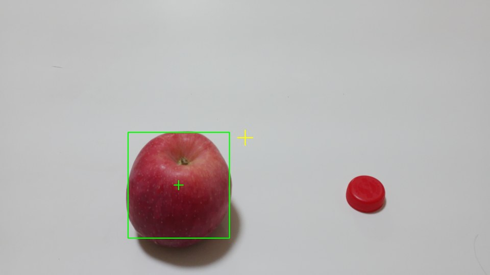
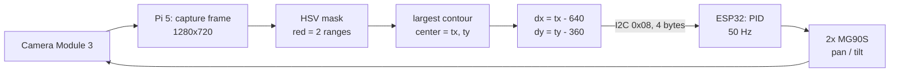

# rpi5-vision-gimbal

A two-axis pan-tilt camera that follows a colored target in real time.

A Raspberry Pi 5 runs the vision. It captures frames, finds the target, and
computes how far the target is from the center of the picture. It sends that
offset to an ESP32 over I²C. The ESP32 turns the offset into PWM for two
servos, so the camera keeps the target in the middle of the frame.



*Green box: tracked target. Green cross: target center. Yellow cross: frame
center. The program prints `dx=-174 dy=124` — the offset the gimbal has to
remove. The red cap on the right is also a valid red object (`候选色块数: 2`),
and the detector deliberately ignores it: the target is the largest blob.*

## Status

| Stage | Goal | Result |
|---|---|---|
| M0 Bring-up | OS, SSH, camera, I²C link, one servo moving | done |
| M1 Capture | Get frames as numpy arrays, measure frame rate | **32.9 fps @ 1280×720** |
| M2 Detection | Find the target by color, print `dx dy` | done |
| M3 Offset link | Send `dx dy` from Pi to ESP32 over I²C | **verified: `dx=108 dy=178`, 3/3 frames bit-exact** |
| M4 Closed loop | PID tracking, pan + tilt | not started |

## How it works



Three details that decide whether this works:

**Red is on both ends of the hue circle.** In OpenCV, hue is 0–179, not a
straight line. Pure red sits near 0 *and* near 179. So the mask is built from
two ranges and then OR-ed together. A single range always loses part of the
target.

**The target is chosen by largest area, not by "the only blob".** A red bottle
cap on the same desk is a real red object; the color filter is right to see it.
The detector picks the biggest candidate and draws only that one.

**`MIN_AREA` is a noise gate, not a target filter.** The target area changes
3x when the camera moves 0.5 m away (measured: 95,664 px → 34,505 px). Any fixed
area threshold that rejects clutter will also reject the real target as soon as
it gets far away.

## Hardware

| Part | Model | Note |
|---|---|---|
| Single-board computer | Raspberry Pi 5 | 5 V / 5 A over USB-C |
| Camera | Camera Module 3 (IMX708) | Pi 5 needs a 22-pin to 15-pin FFC cable |
| MCU | ESP32 DevKit V1, 30-pin (WROOM-32) | I²C slave at address 0x08 |
| Servo | MG90S, metal gear, 180° | one wired so far, second for M4 |
| Bracket | 2-axis pan-tilt, SG90 size | |
| Servo power | 5 V / 3 A, separate supply | must not share the Pi's 5 V rail |

The servo supply is separate on purpose. Servos pull spikes that a shared rail
cannot absorb, and the Pi browns out and reboots.

### Wiring

| From | To |
|---|---|
| ESP32 D21 (GPIO21) | Pi pin 3 (GPIO2, SDA) |
| ESP32 D22 (GPIO22) | Pi pin 5 (GPIO3, SCL) |
| ESP32 GND | Pi pin 9 (pin 6 is taken by the fan) |
| Servo signal (orange) | ESP32 D13 |
| Servo power (red / brown) | 5 V / 3 A supply, ground tied to ESP32 GND |

## Repository layout

```
scripts/
  pi/                     Python, runs on the Raspberry Pi 5
    m1_capture.py         capture frames, measure frame rate
    m2_probe.py           print the HSV values of the target (threshold helper)
    m2_detect.py          threshold, find target, print dx dy, save an image
    m3_send.py            detect once, pack dx dy, send over I2C to the ESP32
    camera_web.py         small web UI for live preview and still capture
  esp32/                  Arduino sketches
    m3_i2c_slave/         I2C slave at 0x08, prints dx dy on serial
    servo_sweep/          servo motion test
    servo_pin_test/       square-wave self test for one GPIO pin
```

## Running the detector

The Pi has no monitor, so every result is a PNG pulled back to a PC.

```bash
scp scripts/pi/m2_detect.py gimbal:/home/xh/
ssh gimbal "python3 /home/xh/m2_detect.py"
scp gimbal:/home/xh/m2_detect.png .
```

Output:

```
候选色块数: 2（>2000 像素的才算候选）
目标 area=51199  框=(334,346) 265x277  中心=(466,484)  画面中心=(640,360)  dx=-174 dy=124
另外 1 个候选比它小，已忽略
```

## Running the offset link

Flash `scripts/esp32/m3_i2c_slave`, open the serial monitor at 115200, then:

```bash
scp scripts/pi/m3_send.py gimbal:/home/xh/
ssh gimbal "python3 /home/xh/m3_send.py"
```

Pi prints `检测: area=11777 dx=108 dy=178` and three `rc=0` lines; the ESP32
serial monitor prints three matching `recv dx=108 dy=178`. Same numbers on both
sides means the byte order, the sign handling and the wiring are all correct.

`dx = target_x - 640`, `dy = target_y - 360`. In image coordinates +x is right
and +y is down.

## Wire format

Pi to ESP32, I²C address `0x08`, 4 bytes, two little-endian signed 16-bit ints:

```
struct.pack("<hh", dx, dy)          # dx=108 dy=178  ->  6c 00 b2 00
i2ctransfer -y 1 w4@0x08 0x6c 0x00 0xb2 0x00
```

Verified bit-exact on both ends: the Pi printed `dx=108 dy=178`, the ESP32
printed `recv dx=108 dy=178`, three frames in a row. Use `i2ctransfer`, not
`i2cget` — `i2cget` sends a register address first, which this slave does not
expect, and you get a garbage byte back.

The slave saves the payload in an interrupt and prints it from `loop()`. Calling
`Serial.print` inside the I²C receive interrupt will stall the bus.

## Field notes

Five things cost real time. They are written down because they will happen
again.

**1. picamera2 returns BGR, not RGB.** The configuration asks for `RGB888`, but
`capture_array()` on a Pi 5 (PISP) hands back BGR. A red apple read as hue 122,
which is blue. Flipping the channels gave 178, which is red. Fix:
`COLOR_BGR2HSV`, and write `frame` to disk without converting. Do not trust the
format string — check with an object whose color you already know.

**2. A multimeter on the DC range cannot measure a servo PWM.** A 50 Hz signal
with a 1.5 ms pulse reads about 0.03 V. That is not "no output", it is a
measurement artifact. To test a pin, flash a sketch that flips the pin every
0.5 s and check that the serial output and the meter agree.

**3. A breadboard row is horizontal.** The five holes in one row are connected.
Holes stacked vertically in the same column are not. Power rails run vertically
but can be split in the middle.

**4. Ground is a three-point problem.** Servo ground, supply negative and MCU
ground must meet at one physical node. A supply has only two pins, so plugging
one into the servo leaves nowhere for the MCU. Use a rail segment as the common
point.

**5. The header has two columns and the numbers skip.** Looking along one column
you see holes 1, 3, 5, 7 in order — pins 4 and 6 are in the *other* column, level
with them. So "the third hole" is not pin 3. Count rows, not holes: the fan sits
on pins 4 and 6, I²C on 3 and 5, two columns apart.

## Roadmap

- **M4** — PID on pan and tilt, tune on the real rig.
- Target numbers: 25 fps or better end to end, 50 Hz control loop, overshoot
  under 20%, settling time under 0.5 s.

## Acknowledgements

The project structure follows [studas/rpi_auto_aim](https://github.com/studas/rpi_auto_aim),
which does the same job with a different split between the two boards.
